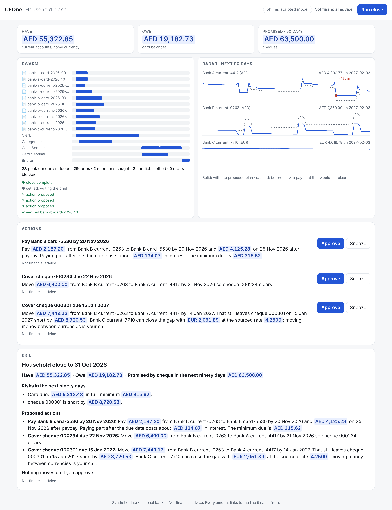
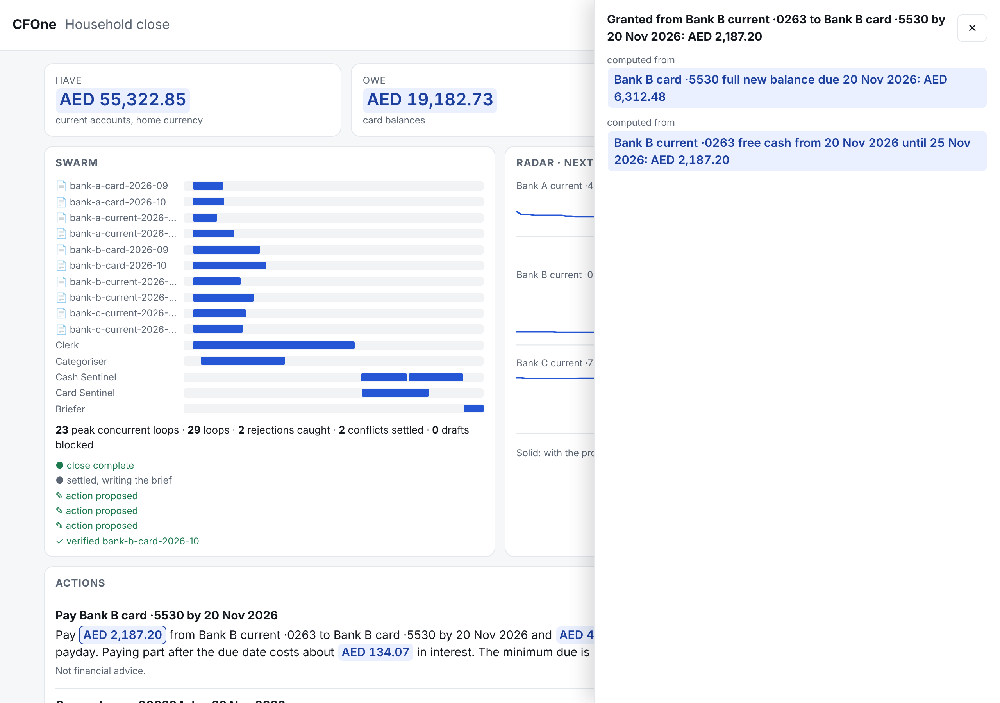
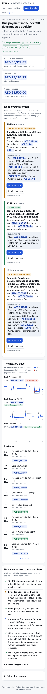
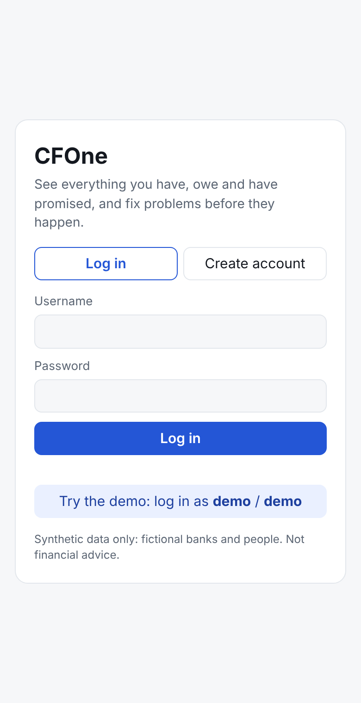

# CFOne

**See everything you have, owe and have promised, and fix problems before they happen.**

CFOne is a team of AI agents that closes a household's books from bank statements of any bank,
format and currency, and warns before a payment bounces or a card charges interest. Built on
[Mozaik](https://docs.jigjoy.ai). First built at the JigJoy Black Friday AI Hackathon, track
*Agents in Finance*.



> The demo uses synthetic data only: fictional people, Bank A, Bank B and Bank C, and
> fictional merchants. Not financial advice.

## Why

My own problem: our money sits in several banks and cards for two people, in more than one
currency, and part of it is already promised, in cheques and instalments dated months and years
ahead. Each bank app shows its own slice. Banks hand out PDFs and CSV exports, each in its own
layout and currency, and nothing reads them all or knows what we have promised. Nobody could
tell us what we have, what we owe, what we have already promised, and whether next month's
payments will clear.

## What it does

Drop in statements from any bank (PDF or CSV, any currency), the cheque register, loan or
payment plans, the cards' key facts and an exchange-rate file. The swarm returns:

- **A verified position in your home currency.** Every statement is reconciled to its own
  totals before it counts; other currencies are converted at a sourced rate, never assumed.
- **A 90-day radar** per account, with the exact day a payment would bounce or a card would
  charge interest.
- **Fixes with sources.** "Move AED 6,400.00 from Bank B current to Bank A current by 21 Nov
  so cheque 000234 clears." Every amount is a chip that opens the line it came from.
- **A heads-up weeks ahead, across currencies.** "The 15 Jan property cheque is AED 8,720.53
  short at the current pace; your Bank C euro account covers it with EUR 2,051.89."
  (Shortfalls include a buffer you set, AED 500.00 in the demo.)

You approve or snooze. CFOne never moves money.

## Run it

**Quickest, with Docker:** `docker compose up -d`, open http://localhost:3000 and press
**Try the demo** (user `demo`, password `demo`), or create your own account. The page runs a
close on start, so numbers are there on first login; **Run close** runs it again live.

**Without Docker,** Node 22 or newer:

```bash
npm install
npm run demo                          # offline: no API key needed (scripted model, same agents)
ANTHROPIC_API_KEY=sk-... npm run demo # live with Claude (claude-sonnet-5-5)
OPENAI_API_KEY=sk-... npm run demo    # live with OpenAI (gpt-5.5)
CFONE_OPENAI_BASE_URL=http://localhost:11434/v1 CFONE_MODEL=<model> npm run demo   # any OpenAI-compatible server
npm start                             # the page on http://localhost:3000 (log in as demo / demo)
npm test
npm run typecheck
```

Or copy `.env.example` to `.env`. The synthetic documents are committed under
`data/synthetic/`; `npm run gen` regenerates them from `data/scenario/`.

**Demo data.** One fictional household (Luka and Mila): ten statements from Bank A, Bank B and
Bank C (PDF and CSV, AED and EUR), a cheque register, a property payment plan, card key facts
and an exchange-rate file. Everything is generated from `data/scenario/household.scenario.json`;
no real bank, person or account appears anywhere.

**Accounts.** Registration and login use scrypt-hashed passwords in `users.json` under
`CFONE_STATE_DIR` (`/data` in Docker, a named volume) and an HttpOnly session cookie; login
attempts are rate-limited. `demo` / `demo` is created on first start. Accounts gate the page; the
household data is the shared synthetic demo.

**Deploy.** `.github/workflows/ci.yml` type-checks, tests and runs the offline demo on every
pull request. `.github/workflows/deploy.yml` runs on the self-hosted runner on every push to
`main`: it builds the image (type-check and tests run inside the build, so a failing check
leaves the running app untouched), replaces the `cfone-mozaik` container on the `maystral`
network, publishes port `3010` (repository variable `CFONE_MOZAIK_PORT` to change it), keeps
accounts in the `cfone-mozaik-data` volume, and waits for the health check
(`GET /healthz`). Repository secrets `ANTHROPIC_API_KEY` or `OPENAI_API_KEY` switch it to a
live model; without them it runs offline. `MOZAIK_API_KEY` turns on Mozaik Cloud telemetry
(content redacted with `MOZAIK_REDACTION=content`, or the repository variable of that name).

## How the agents run concurrently

- **One Mozaik runtime, one reader per statement.** In the demo: ten readers, a clerk,
  a categoriser, an auditor, a matcher, a forecaster, a treasurer, two sentinels, a briefer,
  an observer, a coordinator and you, twenty-two participants.
- **Nobody calls anybody.** Participants react to events through Mozaik situation
  specifications and share one typed `HouseholdState`. There is no orchestrator loop.
- **Loops overlap for real.** Each LLM agent starts its loop with `runLoop`, which is not
  awaited, and gets its own fresh context. The readers and the clerk's three loops start
  together; the auditor checks each statement the moment it lands while others are still being
  read; both sentinels then plan at the same time and compete for the same cash.
- **Measured, not claimed.** Every run prints the lane chart and
  `peak concurrent loops · LLM loops · rejections caught · conflicts settled · drafts blocked`.
  An offline run on the demo data ([full log](docs/runs/2026-11-25-offline.md)):

  ```
  participants: 22 · peak concurrent loops: 23 · LLM loops: 29 · rejections caught: 2 · conflicts settled: 2 · drafts blocked: 0 · facts: 94
  ```

  Peak concurrent loops counts loops open at once (ten readers, the clerk's three documents and
  the categoriser's ten statements overlap); the `SafeRunner` caps inferences actually in flight
  at six (`CFONE_MAX_IN_FLIGHT`) to respect provider rate limits. Try `CFONE_CHAOS=1 npm run demo`
  to watch the Number Guard block drafts that type a number.

## The checks between agents

| Check | Who | What it stops |
|---|---|---|
| Source check | Auditor | A row whose cited line does not show that amount |
| Reconciliation gate | Auditor | A statement that does not add up exactly to its own totals or running balance. The reader re-reads with a hint ("difference 165.13 equals 'Finance charges' on p1:l8"); two failures quarantine it |
| Arbitration | Treasurer | Two sentinels spending the same money. Claims compete inside a paycheck window by priority (cheque, autopay, card); the result does not depend on who was faster |
| Number Guard | Mozaik interception | Any action or brief with a digit the model typed. Amounts can only be fact placeholders computed by code |
| Approval | You | Anything happening without you. Actions are proposals |

## The agents

| Agent | Kind | Job |
|---|---|---|
| Reader, one per statement | LLM | Reads one statement of any layout (PDF or CSV) and submits rows with `page:line` sources |
| Auditor | code | Source check, reconciliation, hints, quarantine |
| Clerk | LLM | Cheque register, payment plans and card terms into commitments and terms |
| Categoriser | LLM (fast) | Labels rows from a fixed list |
| Matcher | code | Links transfers and card payments between own accounts |
| Forecaster | code | Recurring items, daily balances per account, conversions, risks, cover suggestions, sourced facts |
| Cash Sentinel | LLM | Covers cheque and autopay shortfalls |
| Card Sentinel | LLM | Pays cards before interest, splits around paydays |
| Treasurer | code | Owns the reservation ledger and settles conflicts |
| Number Guard | code | Interception on every action and brief |
| Briefer | LLM | Writes the household brief from facts only |
| Coordinator, Observer | code | Route documents and rates; measure spans, metrics and live events |

## Care with financial data

- No bank logins: statements in, nothing out.
- Synthetic demo data, generated from a committed scenario. No real bank names or branding.
- Money is integer minor units with a currency; a statement counts only after it reconciles;
  rates come from a file with a source line, and a currency without a rate is shown as missing.
- Models never do arithmetic and cannot type amounts.
- Every amount shown links to its source line or to the facts it was computed from.
- Read-only. "Not financial advice" on the brief and every action.
- Mozaik Cloud telemetry is off unless you set `MOZAIK_API_KEY`; `.env.example` sets
  `MOZAIK_REDACTION=content`.


## Layout

```
src/            runtime, agents, domain logic, inference, CLI, server, accounts
web/            the page (no build step)
data/synthetic/ generated documents the app reads
data/scenario/  the scenario and golden values (generator and tests only)
docs/           design, plan, data spec, Mozaik notes, demo script
tests/          node:test suites
```

## Screens

| Source drawer | Phone width | Log in |
|---|---|---|
|  |  |  |

## Limits and next

- The demo reads five synthetic layouts across three banks; the readers have no bank-specific
  code. Scanned statements need OCR first.
- Moving money between currencies is suggested, not reserved.
- The live-model prompts are written but this build has only been run end to end with the
  offline scripted model; a recorded live run is still to come.
- Next: scans and more formats, cross-currency planning with sourced rates, a second rule-based
  reader on every statement, and "Ask CFOne" questions answered by parallel analysts behind the
  same Number Guard.

MIT licence. Built on `@mozaik-ai/core` 4.2.0 by JigJoy.
